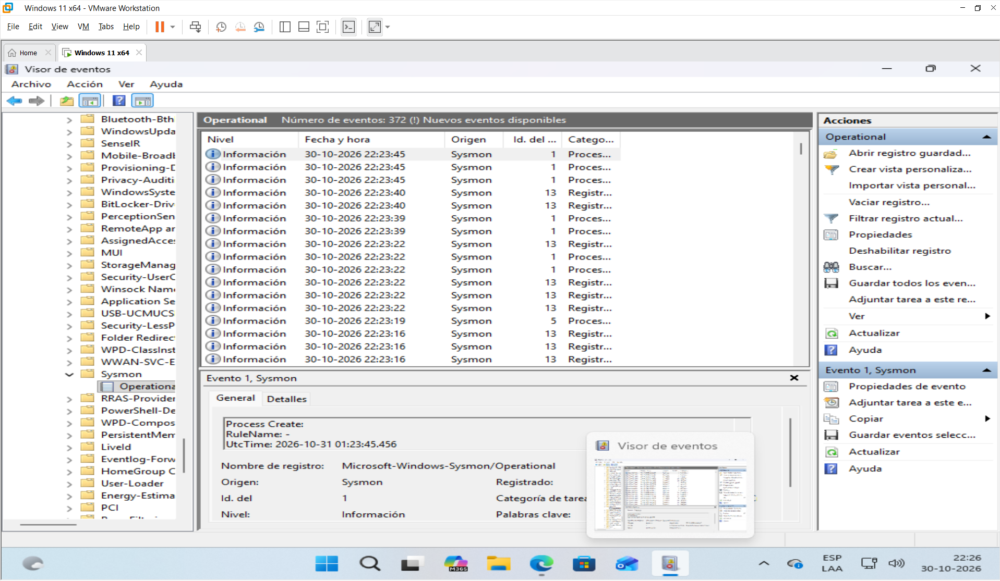
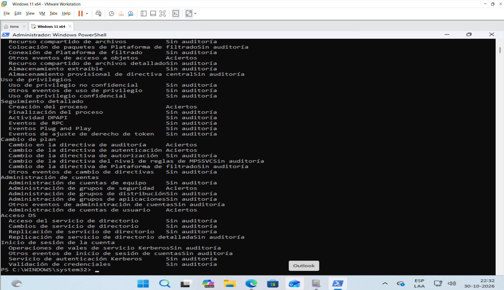
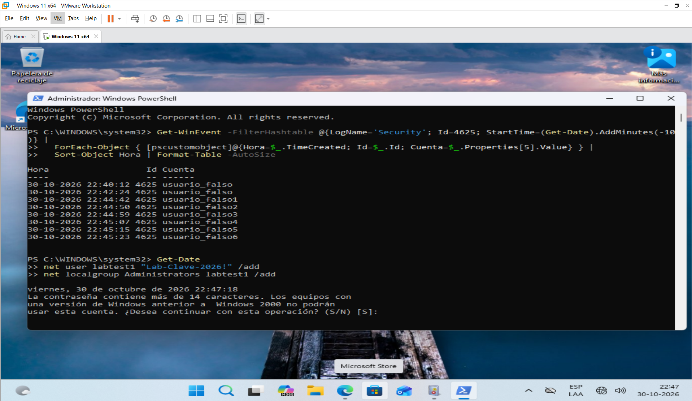
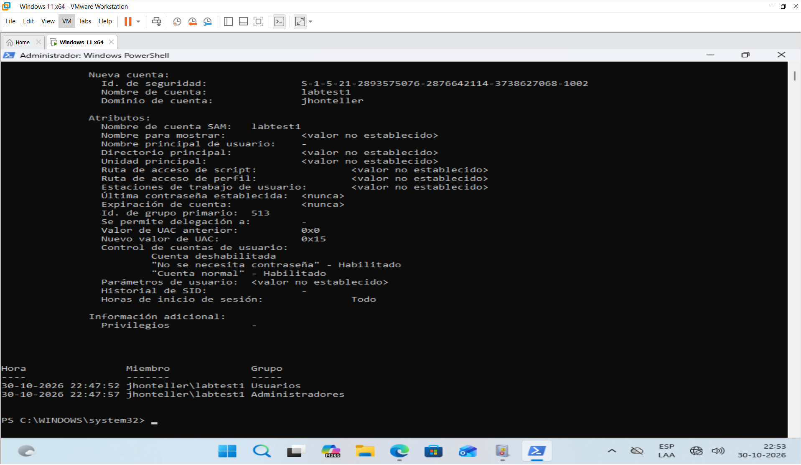
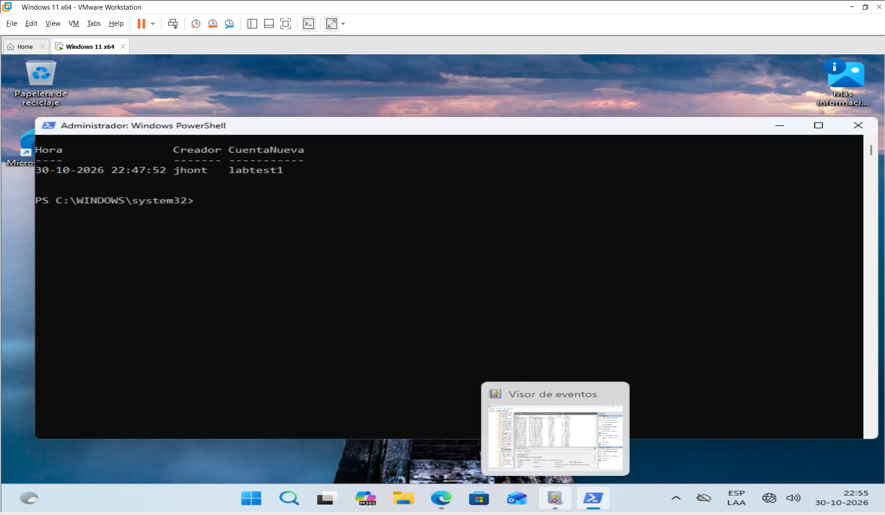
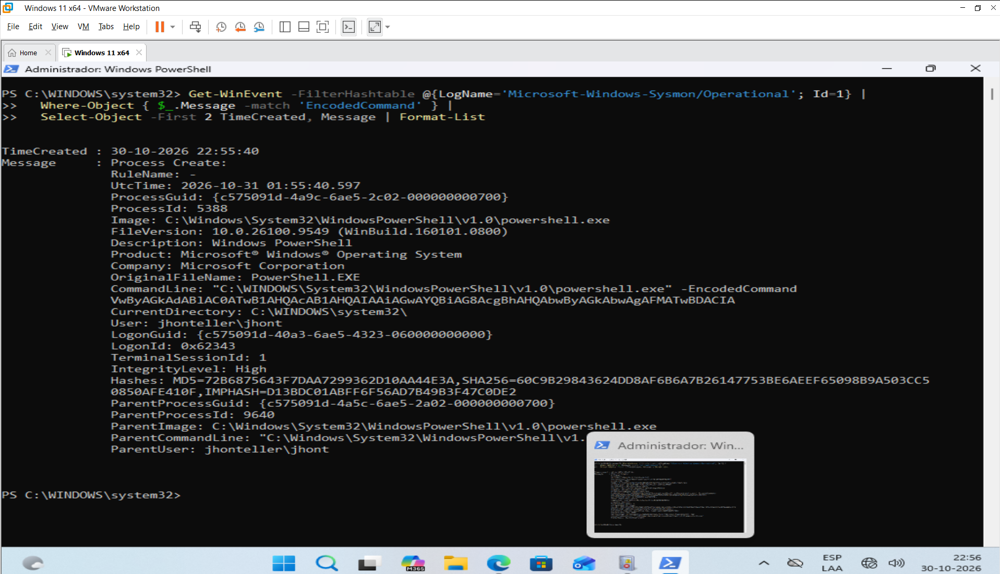
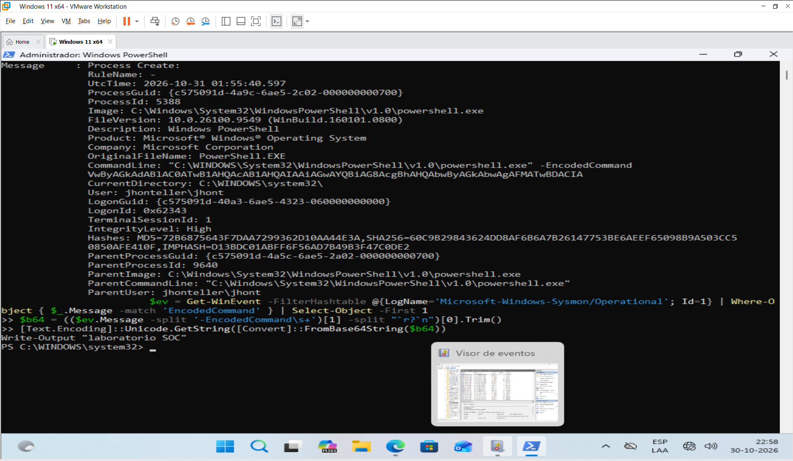
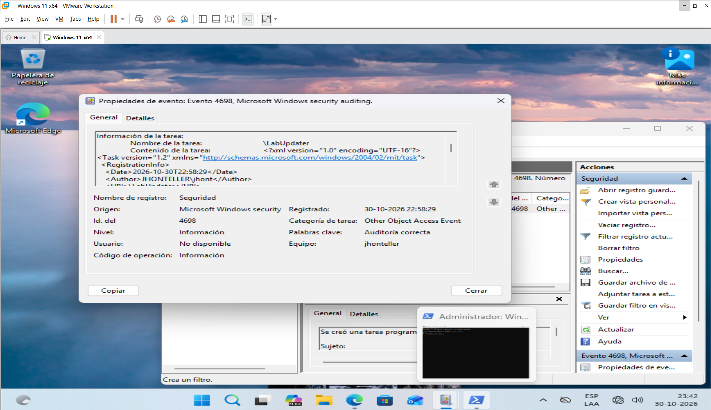
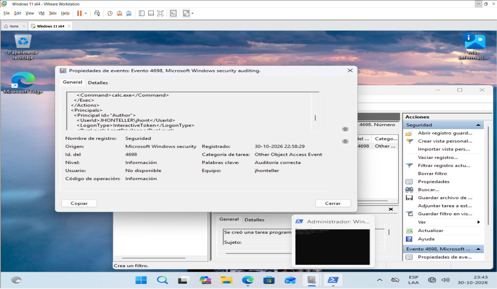
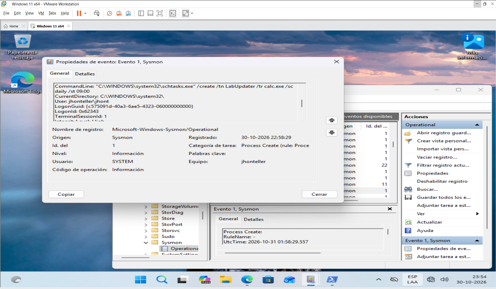

# Laboratorio: Investigación de un ataque en Windows (nivel analista SOC)

- **Autor:** Tomás
- **Fecha de ejecución:** 30-10-2026 (hora local de la VM, UTC-3)
- **Entorno:** VMware Workstation, Windows 11 (VM aislada, sin datos reales)
- **Herramientas:** Visor de eventos, PowerShell (`Get-WinEvent`), Sysmon v15.22 con la configuración de SwiftOnSecurity

> Todo el laboratorio se ejecutó en una VM de pruebas creada por mí, aislada de la red (Host-only). Las acciones simuladas son inofensivas y sirven solo para generar registros que luego investigo como analista.

---

## 1. Objetivo

Simular un ataque básico a un equipo Windows y luego investigarlo como lo haría un analista SOC: encontrar la evidencia en los registros, reconstruir la línea de tiempo, mapear las técnicas a MITRE ATT&CK y proponer recomendaciones.

## 2. Escenario

Un equipo Windows muestra actividad sospechosa: intentos de acceso fallidos, una cuenta nueva con permisos de administrador, un comando de PowerShell codificado y una tarea programada desconocida.

Pregunta a responder: **¿qué pasó, cuándo, con qué cuenta y cómo se mantuvo el acceso?**

## 3. Preparación del entorno

1. VM Windows 11 con cuenta local, red en NAT solo durante la instalación y luego en **Host-only**. Comprobé el aislamiento: Edge no resolvía ninguna página (error DNS).
2. Instalé Sysmon v15.22 con la configuración de SwiftOnSecurity (`sysmonconfig-export.xml`). Esa configuración no se actualiza desde hace años, pero sigue siendo una base muy usada.
3. Activé auditoría en PowerShell como administrador. Mi Windows está en español, así que usé los identificadores (GUID) de cada subcategoría en lugar de los nombres:

```powershell
auditpol /set /subcategory:"{0CCE9215-69AE-11D9-BED3-505054503030}" /success:enable /failure:enable   # Inicio de sesión
auditpol /set /subcategory:"{0CCE922B-69AE-11D9-BED3-505054503030}" /success:enable                   # Creación del proceso
auditpol /set /subcategory:"{0CCE9235-69AE-11D9-BED3-505054503030}" /success:enable                   # Administración de cuentas de usuario
auditpol /set /subcategory:"{0CCE9237-69AE-11D9-BED3-505054503030}" /success:enable                   # Administración de grupos de seguridad
auditpol /set /subcategory:"{0CCE9227-69AE-11D9-BED3-505054503030}" /success:enable                   # Otros eventos de acceso a objetos
```

Verifiqué con `auditpol /get /category:*` que las cinco quedaron en *Aciertos*.





## 4. Simulación (generación de evidencia)

| Paso | Acción | Hora de inicio |
|---|---|---|
| A | Accesos fallidos a `\\<equipo>\IPC$` con usuarios inexistentes | 22:44:42 |
| B | Creación de la cuenta `labtest1` y elevación a Administradores | 22:47:18 |
| C | `powershell.exe -EncodedCommand` con un comando inofensivo | 22:55:40 |
| D | Tarea programada `LabUpdater` que ejecuta `calc.exe` | 22:58:29 |

**Paso A**
```powershell
1..6 | ForEach-Object { net use \\$env:COMPUTERNAME\IPC$ /user:usuario_falso$_ ClaveIncorrecta123; Start-Sleep -Seconds 2 }
```

**Paso B** (en mi Windows en español el grupo se llama *Administradores*; el primer intento con `Administrators` falló con el error 1376)
```powershell
net user labtest1 "Lab-Clave-2026!" /add
net localgroup Administradores labtest1 /add
```

**Paso C**
```powershell
$c = 'Write-Output "laboratorio SOC"'
$e = [Convert]::ToBase64String([Text.Encoding]::Unicode.GetBytes($c))
powershell -EncodedCommand $e
```

**Paso D**
```powershell
schtasks /create /tn "LabUpdater" /tr "calc.exe" /sc daily /st 09:00
```

## 5. Investigación

Desde aquí actúo como analista y trabajo solo con los registros.

### 5.1 Intentos de acceso fallidos (Security, evento 4625)

```powershell
Get-WinEvent -FilterHashtable @{LogName='Security'; Id=4625; StartTime=(Get-Date).AddMinutes(-10)} |
  ForEach-Object { [pscustomobject]@{Hora=$_.TimeCreated; Id=$_.Id; Cuenta=$_.Properties[5].Value} } |
  Sort-Object Hora | Format-Table -AutoSize
```

**Hallazgos**
- Última tanda: **6 eventos 4625** entre 22:44:42 y 22:45:23, uno por cada cuenta (`usuario_falso1` a `usuario_falso6`), separados por unos 8 segundos.
- Hice dos tandas previas con **un único usuario repetido** (22:40:12 y 22:42:24). Aunque envié 6 intentos en cada una, Windows registró **un solo evento 4625 por tanda**. No confirmé la causa; mi hipótesis es que el cliente SMB consolida intentos repetidos con el mismo usuario y destino. Conclusión práctica: el número de eventos puede ser menor que el número de intentos reales, y conviene no depender solo del conteo.
- Hay un 4625 de las 18:59:00, anterior a la simulación (probablemente del proceso de instalación). Lo descarté filtrando por hora.



### 5.2 Cuenta nueva y elevación de privilegios (eventos 4720 y 4732)

```powershell
Get-WinEvent -FilterHashtable @{LogName='Security'; Id=4720} -MaxEvents 1 | Format-List TimeCreated, Message
Get-WinEvent -FilterHashtable @{LogName='Security'; Id=4732; StartTime=(Get-Date).AddMinutes(-20)} |
  ForEach-Object {
    $sid = $_.Properties[1].Value
    $m = try { $sid.Translate([Security.Principal.NTAccount]).Value } catch { "$sid" }
    [pscustomobject]@{Hora=$_.TimeCreated; Miembro=$m; Grupo=$_.Properties[2].Value}
  } | Sort-Object Hora | Format-Table -AutoSize
```

**Hallazgos**
- **22:47:52, evento 4720:** la cuenta local de la VM crea la cuenta `labtest1`.
- **22:47:52, evento 4732:** `labtest1` entra al grupo *Usuarios*. Es automático al crear la cuenta y no es sospechoso por sí solo.
- **22:47:57, evento 4732:** `labtest1` entra al grupo **Administradores**. Esta es la elevación de privilegios y el evento clave.
- Hay dos 4732 de las 18:50:02, de la instalación del sistema, que no corresponden a la simulación.





### 5.3 PowerShell con comando codificado (Sysmon, evento 1)

```powershell
Get-WinEvent -FilterHashtable @{LogName='Microsoft-Windows-Sysmon/Operational'; Id=1} |
  Where-Object { $_.Message -match 'EncodedCommand' } |
  Select-Object -First 2 TimeCreated, Message | Format-List
```

**Hallazgos (22:55:40)**
- Proceso `powershell.exe` lanzado con `-EncodedCommand VwByAGkAdABlAC0ATwB1AHQAcAB1AHQA...` (Base64 en UTF-16).
- Usuario de la VM, con `IntegrityLevel: High` (administrador).
- Proceso padre: otro `powershell.exe`, porque lancé el comando desde una consola. En un ataque real el padre suele ser más sospechoso (Office, navegador, `cmd.exe`, un servicio).
- Decodificado, el comando es `Write-Output "laboratorio SOC"`.

```powershell
$ev = Get-WinEvent -FilterHashtable @{LogName='Microsoft-Windows-Sysmon/Operational'; Id=1} | Where-Object { $_.Message -match 'EncodedCommand' } | Select-Object -First 1
$b64 = (($ev.Message -split '-EncodedCommand\s+')[1] -split "`r?`n")[0].Trim()
[Text.Encoding]::Unicode.GetString([Convert]::FromBase64String($b64))
```





### 5.4 Persistencia: tarea programada (Security 4698 y Sysmon 1)

**Hallazgos (22:58:29)**
- **Evento 4698:** tarea `\LabUpdater`, creada por la cuenta de la VM, con disparador diario a las 09:00 y acción `calc.exe`.
- La tarea corre con la misma cuenta que la creó (`InteractiveToken`, `LeastPrivilege`), no como SYSTEM.
- **Sysmon 1:** `schtasks.exe` con la línea de comandos `/create /tn LabUpdater /tr calc.exe /sc daily /st 09:00`, `IntegrityLevel: High`, proceso padre `powershell.exe`.
- En el encabezado del evento de Sysmon el campo *Usuario* dice SYSTEM, pero ese campo indica quién escribió el registro. El usuario real del proceso está dentro del texto, en `User:`.







## 6. Línea de tiempo reconstruida

| Hora | Evento | Qué ocurrió |
|---|---|---|
| 22:44:42 a 22:45:23 | 4625 (x6) | Accesos fallidos con `usuario_falso1` a `usuario_falso6` |
| 22:47:52 | 4720 | Se crea la cuenta `labtest1` |
| 22:47:52 | 4732 | `labtest1` entra a *Usuarios* (automático) |
| 22:47:57 | 4732 | `labtest1` entra a *Administradores* |
| 22:55:40 | Sysmon 1 | `powershell.exe -EncodedCommand` |
| 22:58:29 | 4698 y Sysmon 1 | Tarea `LabUpdater` creada con `schtasks.exe` |

## 7. Mapeo a MITRE ATT&CK

| Actividad observada | Técnica | ID |
|---|---|---|
| Múltiples accesos fallidos | Brute Force | T1110 |
| Creación de cuenta local | Create Account: Local Account | T1136.001 |
| Cuenta agregada a administradores | Account Manipulation | T1098 |
| PowerShell con comando codificado | Command and Scripting Interpreter: PowerShell | T1059.001 |
| Comando ofuscado en Base64 | Obfuscated Files or Information | T1027 |
| Tarea programada | Scheduled Task/Job: Scheduled Task | T1053.005 |

## 8. Indicadores de compromiso (IOC)

| Tipo | Valor |
|---|---|
| Cuenta creada | `labtest1` |
| Tarea programada | `LabUpdater` (ejecuta `calc.exe`, diaria 09:00) |
| Proceso sospechoso | `powershell.exe -EncodedCommand VwByAGkAdABlAC0ATwB1AHQAcAB1AHQA...` |
| Proceso de persistencia | `schtasks.exe /create /tn LabUpdater ...` |
| Cuentas usadas en accesos fallidos | `usuario_falso`, `usuario_falso1` a `usuario_falso6` |

## 9. Hallazgos y nivel de riesgo

| # | Hallazgo | Riesgo | Justificación |
|---|---|---|---|
| 1 | Cuenta con permisos de administrador creada y elevada en 5 segundos | Alto | Da acceso total y duradero al equipo, y puede usarse aunque se cambie la contraseña de la cuenta original |
| 2 | Persistencia mediante tarea programada | Alto | Permite ejecutar algo en cada día sin intervención y sobrevive a reinicios |
| 3 | PowerShell con comando codificado | Medio | La codificación oculta el contenido a una revisión rápida; el riesgo real depende de lo que decodifique |
| 4 | Accesos fallidos repetidos | Medio | Indica intento de adivinar credenciales; sin un éxito posterior no hay evidencia de compromiso por esta vía |

*Niveles de riesgo según mi criterio para este laboratorio, en un entorno controlado.*

## 10. Qué diferencia esta simulación de un ataque real

- Las acciones las hizo la misma cuenta administradora local; en un incidente real habría que averiguar cómo obtuvo el atacante esa cuenta.
- El proceso padre de PowerShell fue otra consola de PowerShell. En un ataque real suele ser una aplicación inesperada.
- La tarea ejecuta `calc.exe`, que es inofensivo. Una persistencia real apuntaría a un ejecutable o script en una ruta poco habitual.
- Los accesos fallidos fueron contra el propio equipo; un ataque real vendría de otra IP.

## 11. Recomendaciones

- Alertar cuando se cree una cuenta nueva o se agregue alguien a Administradores (eventos 4720 y 4732), sobre todo si ocurren con pocos segundos de diferencia.
- Alertar ante varios 4625 seguidos y revisar si hay un 4624 exitoso después.
- Registrar y revisar los comandos de PowerShell codificados (`-EncodedCommand`), y activar el registro de bloques de script.
- Revisar las tareas programadas nuevas (evento 4698) y sus rutas de ejecución.
- Aplicar bloqueo de cuenta tras varios intentos fallidos y el principio de mínimo privilegio.

## 12. Conclusión

En este laboratorio simulé, en una VM aislada, cuatro acciones típicas de un atacante en Windows (accesos fallidos, creación de una cuenta administradora, PowerShell codificado y persistencia con una tarea programada) y las investigué usando solo los registros. Reconstruí qué pasó, cuándo y con qué cuenta combinando los eventos de Seguridad (4625, 4720, 4732 y 4698) con el evento 1 de Sysmon, que además me dio la línea de comandos completa y el proceso padre, algo clave para el paso del comando codificado. Lo más difícil fue trabajar con un Windows en español: el grupo se llama *Administradores* y tuve que activar la auditoría con GUID. También aprendí que contar eventos no es lo mismo que contar intentos, porque Windows registró un solo 4625 cuando repetí el mismo usuario. Y que un evento aislado dice poco: lo que hace sospechosa a la cuenta nueva es la secuencia 4720 seguido de 4732 en solo cinco segundos.

## 13. Limpieza del entorno

```powershell
net user labtest1 /delete
schtasks /delete /tn "LabUpdater" /f
```

## 14. Estructura del repositorio

```
laboratorio-ataque-windows/
├── README.md
├── capturas/
│   ├── 01_preparacion.png
│   ├── 01b_auditoria.png
│   ├── 02_logon_fallidos.png
│   ├── 03_cuenta_y_grupo.png
│   ├── 03b_creador_cuenta.png
│   ├── 04_powershell_codificado.png
│   ├── 04b_base64_decodificado.png
│   ├── 05a_tarea_nombre.png
│   ├── 05b_tarea_comando.png
│   └── 05c_sysmon_schtasks.png
└── consultas/
    └── consultas_powershell.ps1
```
